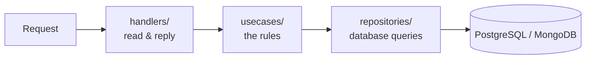
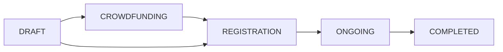
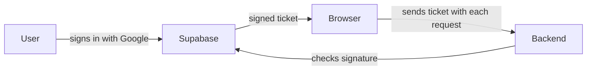

# Backend

The hidden server behind Eventory. It checks the rules and owns the database. Written in Go.

Setup and run instructions live in **[Getting Started](../docs/getting-started.md)**. This page is about the code.

---

## Run it

From the repo root, pick one:

```bash
# Postgres, MongoDB, Traefik, Account, Tournament, Payment, frontend on the host
task dev

# or the same stack without the frontend
task dev:backend
```

Both run `task migrate` first: Account, Tournament, and Payment schemas. `task migrate` alone starts Postgres and applies those schemas. It does not start the APIs.

```bash
# sample rows, after the apps are healthy
task seed
```

To run a service on the host instead of in Compose, use `task migrate`, then:

```bash
go run ./services/account/cmd/api
go run ./services/tournament/cmd/api
go run ./services/payment/cmd/api
go run ./services/notification/cmd/api
```

`8081`, `9091`, `8082`, and `8083` must be free, so do not leave `task dev:backend` running. Traefik on `:8080` forwards to the containers, not to these host processes. Call `:8081`, `:8082`, and `:8083` directly. MongoDB runs on port `27017` as a secondary database for the Tournament Service.

| URL                          | What                                |
| ---------------------------- | ----------------------------------- |
| http://localhost:8081/docs   | Account endpoints                   |
| http://localhost:8082/docs   | Tournament endpoints                |
| http://localhost:8083/docs   | Payment endpoints                   |
| http://localhost:8080/health | Gateway health check                |
| localhost:27017              | MongoDB (database: `tournament_db`) |

---

## Where things go

A request travels through four layers within each microservice (`account`, `tournament`, `payment`). Each layer has a single job.



| Folder                                   | Job                                                         | Example question it answers                   |
| ---------------------------------------- | ----------------------------------------------------------- | --------------------------------------------- |
| `services/<name>/handlers/`              | Read the request, send the reply                            | "What did the browser send?"                  |
| `services/<name>/internal/usecases/`     | The actual rules                                            | "Is this user allowed to close registration?" |
| `services/<name>/internal/repositories/` | Database reads and writes                                   | "Fetch tournament 123"                        |
| `services/<name>/models/`                | Shape of each table or collection document                  | "What columns does a tournament have?"        |
| `services/<name>/cmd/`                   | One service each: `cmd/api`, `cmd/migrate`, and `cmd/seed`  | —                                             |
| `internal/`                              | Shared across services: `config`, `database`, `middlewares` | "Is this person logged in?"                   |

**Why split it up:** each microservice under `services/<name>` owns its domain logic and databases. Inside each service, rules in `usecases/` stay readable and testable because they contain no web code and no database queries.

---

## Tournament Lifecycle & Mutation Rules

Tournaments progress through five canonical statuses (`DRAFT`, `CROWDFUNDING`, `REGISTRATION`, `ONGOING`, `COMPLETED`). Visibility is derived directly from status: a tournament is public if and only if `status != 'DRAFT'`.



### Valid State Transitions (`PATCH /api/v1/tournaments/{id}/status`)

All manual status transitions require the caller to be the tournament **Owner** and use optimistic concurrency control (`WHERE id = ? AND status = ?`).

| Transition | Preconditions & Validation Rules |
| --- | --- |
| `DRAFT` ➔ `CROWDFUNDING` | • `Funding` is configured with `GoalAmount > 0` and a future `Deadline` (`Deadline > now`).<br/>• If `RegistrationDeadline` is set, `Funding.Deadline < RegistrationDeadline`.<br/>• At least one active sponsorship tier exists (`archived = false`, `price > 0`, `slots >= 1`). |
| `DRAFT` ➔ `REGISTRATION` | • General info (`Name`, `Game`, `Location`) is non-empty.<br/>• Registration Gate is complete: `Capacity >= 1`, `EntryFee >= 0`, valid `RegistrationMode` (`SOLO` with `1/1` team size, or `TEAM` with `1 <= MinTeamSize <= MaxTeamSize`).<br/>• Timeline is complete and ordered: `now < RegistrationDeadline < StartsAt < EndsAt`. |
| `CROWDFUNDING` ➔ `REGISTRATION` | • All `DRAFT` ➔ `REGISTRATION` gate and timeline rules are met.<br/>• `Funding.Deadline < RegistrationDeadline`.<br/>• `Funding.RaisedAmount >= Funding.GoalAmount`, unless `force: true` is explicitly passed by the owner. |
| `REGISTRATION` ➔ `ONGOING` | • Registration deadline has passed (`now >= RegistrationDeadline`).<br/>• No unresolved team applications remain (`FORMING`, `PAYMENT_PENDING`, or `LOCKED` count is `0`).<br/>• At least 2 `ACCEPTED` teams exist.<br/>• A valid match bracket exists with a championship match (`TargetMatchID == nil`), Stage 1 slot capacity equals the `ACCEPTED` team count, and all Stage 1 slots are seeded. |
| `ONGOING` ➔ `COMPLETED` | • Every match in the bracket has `IsCompleted == true`.<br/>• The championship match (`TargetMatchID == nil`) has a single undisputed winner (`FinalRank == 1`). |

### `REGISTRATION` Open vs. Closed Substates

Within `REGISTRATION`, operational rules split dynamically based on `IsRegistrationClosed(now)` (`!now.Before(RegistrationDeadline)`):

- **Open (`now < RegistrationDeadline`):**
  - Competitors can create team lobbies, join via invite code, submit/update registration form answers, pay entry fees, and lock rosters.
  - Organizers can review (`ACCEPT` / `REJECT`) locked applications.
  - Match bracket creation and seeding are **blocked** (`ErrRegistrationStillOpen`).
- **Closed (`now >= RegistrationDeadline`):**
  - Competitors can no longer create lobbies, join teams, edit form answers, or lock rosters.
  - Organizers can finish reviewing remaining `LOCKED` applications.
  - Organizers can define the match bracket (`POST /bracket`) and seed Stage 1 (`POST /seed`).

### Data Mutation Matrix by Status

| Data / Field Group | Fields / Resources | `DRAFT` | `CROWDFUNDING` | `REGISTRATION` | `ONGOING` | `COMPLETED` |
| --- | --- | :---: | :---: | :---: | :---: | :---: |
| **General Info** | `Name`, `Description`, `Detail`, `Game`, `Location` | Editable | Editable | Editable | Editable | Locked |
| **Registration Gate** | `RegistrationMode`, `EntryFee`, `MinTeamSize`, `MaxTeamSize`, `Capacity` | Editable (optional) | Editable | **Locked** | **Locked** | Locked |
| **Registration Form** | Dynamic MongoDB form schema (`PUT /form`) | Editable | Editable | **Locked** | **Locked** | Locked |
| **Registration Deadline** | `RegistrationDeadline` (`< StartsAt`) | Editable (optional) | Editable | Editable | **Locked** | Locked |
| **Event Timeline** | `StartsAt`, `EndsAt` (`RegistrationDeadline < StartsAt < EndsAt`) | Editable (optional) | Editable | Editable | **Locked** | Locked |
| **Crowdfunding & Tiers** | `FundingGoal`, `FundingDeadline`, `SponsorshipTier` CRUD | Editable | **Locked** | **Locked** | **Locked** | Locked |
| **Sponsorship Pledges** | Sponsor self-serve checkout (`POST .../checkout`) | Blocked | **Open** (if `< EndsAt`) | **Open** (if `< EndsAt`) | **Open** (if `< EndsAt`) | Locked |
| **Team Applications** | Organizer review (`ACCEPT` / `REJECT` `LOCKED` teams) | Blocked | Blocked | **Open** | Blocked | Locked |
| **Bracket Structure** | Define bracket layout & seed Stage 1 (`POST /bracket`, `/seed`) | Blocked | Blocked | **Editable after `RegistrationDeadline`** | **Locked** | Locked |
| **Match Runtime** | Record match results (`POST /matches/{matchId}/results`) | Blocked | Blocked | Blocked | **Editable** | Locked |
| **Staff & Announcements** | Manage `TournamentStaff`, post `TournamentAnnouncement` | Editable | Editable | Editable | Editable | Editable |

---

## Adding an endpoint

1. Add or update a table shape in `services/<name>/models/`.
2. Add the query in `services/<name>/internal/repositories/`.
3. Put the rules in `services/<name>/internal/usecases/`, and write a test next to it.
4. Register the endpoint in `services/<name>/handlers/` with `huma.Register(...)`.
5. Check it appears at http://localhost:8081/docs, http://localhost:8082/docs, or http://localhost:8083/docs.
6. Tell the frontend about it. The apps must be up (`task dev:backend`):

```bash
# from backend/
npm --prefix ../frontend run openapi:generate
```

Step 6 is required. The frontend gets its types from the running backend, so skipping it leaves the frontend blind to your new endpoint.

---

## Commands

| Command                                    | Does                                                                                                 |
| ------------------------------------------ | ---------------------------------------------------------------------------------------------------- |
| `go run ./services/account/cmd/migrate`    | Create or update Account tables. `-reset` drops `public` first                                       |
| `go run ./services/tournament/cmd/migrate` | Create or update Tournament tables, including the search indexes. `-reset` drops `public` first      |
| `go run ./services/account/cmd/api`        | Account on the host. Reads `services/account/.env.default`                                           |
| `go run ./services/tournament/cmd/api`     | Tournament on the host. Reads `services/tournament/.env.default`                                     |
| `go run ./services/payment/cmd/api`        | Payment on the host. Reads `services/payment/.env.default`                                           |
| `go run ./services/notification/cmd/api`   | Notification worker and internal health server on the host                                           |
| `go run ./services/account/cmd/seed`       | Sample accounts                                                                                      |
| `go run ./services/tournament/cmd/seed`    | Sample tournaments                                                                                   |
| `go test ./...`                            | Run the tests                                                                                        |
| `go build ./services/account/cmd/api`      | Check Account still compiles                                                                         |
| `go build ./services/tournament/cmd/api`   | Check Tournament still compiles                                                                      |
| `go build ./services/payment/cmd/api`      | Check Payment still compiles                                                                         |
| `go build ./services/notification/cmd/api` | Check Notification still compiles                                                                    |
| `task gen-proto`                           | From the repo root. Lint and regenerate gRPC code. Needs [Buf](https://buf.build/docs/installation/) |

Run `go test ./...` before opening a pull request.

---

## Settings

Each service loads `services/<name>/.env.default`, then an optional `.env` in that same directory, then the process environment.

| Setting                | Meaning                                                                                 |
| ---------------------- | --------------------------------------------------------------------------------------- |
| `HTTP_PORT`            | Account listens on 8081. Tournament listens on 8082                                     |
| `GRPC_PORT`            | Account gRPC port. Default 9091                                                         |
| `DB_DSN`               | Database address. Account uses `account_db`. Tournament uses `tournament_db`            |
| `DB_MAX_OPEN_CONNS`    | Postgres pool cap per process. Default 20. Keep services × cap under `max_connections`  |
| `ACCOUNT_GRPC_ADDR`    | Where Tournament calls Account. `127.0.0.1:9091` on the host, `account:9091` in Compose |
| `MONGO_URI`            | MongoDB connection URI for Tournament Service dynamic forms                             |
| `MONGO_DB_NAME`        | MongoDB database name for Tournament Service (`tournament_db`)                          |
| `PAYMENT_SERVICE_KEY`  | Server-only secret for Payment gRPC metadata (`x-payment-service-key`)             |
| `AMQP_URL`             | RabbitMQ connection used by Notification                                                |
| `SMTP_*`               | Notification SMTP relay, credentials, sender, TLS, and timeout                          |
| `RETRY_DELAYS`         | Notification retry TTLs; project default `30s,5m,30m`                                   |
| `SUPABASE_URL`         | Used to verify login tickets                                                            |
| `CORS_ALLOWED_ORIGINS` | Which websites may call this API                                                        |

Compose replaces `DB_DSN` so the containers talk to the `postgres` hostname. Host `go run` keeps the `localhost` value from `.env.default`.

---

## Login, briefly



The backend never sees a password. It only checks that the ticket's signature is genuine.

---

Something broken? → **[Troubleshooting](../docs/troubleshooting.md)**

### Internal Payment gRPC

Payment exposes trusted operations at `localhost:9093` (`GRPC_PORT`); Tournament uses `PAYMENT_GRPC_ADDR=payment:9093` in Compose. All RPCs require `x-payment-service-key` metadata matching `PAYMENT_SERVICE_KEY`. These use the private service network, following Account's plaintext gRPC transport; production does not publish this port.

The contract is `services/payment/api/proto/payment/v1/payment.proto`: `CreatePayment`, `GetPayment`, and `RefundRegistration`. Creation and refunds are idempotent; Tournament applies a five-second deadline and bounded retries for transient errors. Invalid inputs return InvalidArgument, unknown invoices NotFound, conflicting requests FailedPrecondition, and missing/incorrect keys Unauthenticated.

The former `/internal/v1/payments` HTTP routes have been removed. Browser checkout, history, and receipts continue through `/api/v1/payments` on HTTP port 8083. Deploy Payment and Tournament together and replace `PAYMENT_URL` with `PAYMENT_GRPC_ADDR` in local overrides. Regenerate both service contracts with `task gen-proto`.
