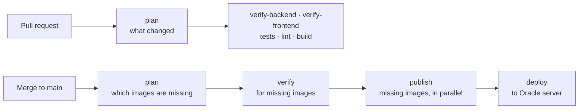

# Deployment

How code gets from a pull request to the live server. Handled automatically by GitHub.

---

## What happens when

| You do | GitHub does |
| --- | --- |
| Open a pull request | Runs backend and/or frontend checks (tests, lint, build), depending on what the PR changes. Nothing is deployed. |
| Merge into `main` | Builds and publishes only the images whose inputs changed, then deploys to the server. |

If a `verify` job fails, nothing is published or deployed.

### Image tags

Each image is tagged with a hash of everything that goes into it, computed by `scripts/image-tag.sh`:

- Backend services: `go.mod`, `go.sum`, `backend/Dockerfile`, the service directory, and every in-module Go package its binaries import. A change to `backend/internal` rebuilds all four services. Tournament also rebuilds when Account's generated proto changes.
- Frontend: the whole `frontend/` directory plus the `NEXT_PUBLIC_*` build values, since `next build` bakes them into the image.

On `main`, `plan` checks GHCR for each tag and builds only the missing ones. Whether an image is built depends on the registry, not on what the latest commit touched. If a build or deploy fails, the next push builds whatever is still missing, even if that push only changes CI. `deploy` runs on every `main` push and writes the five tags into the server's `.env` as `ACCOUNT_IMAGE_TAG`, `TOURNAMENT_IMAGE_TAG`, `PAYMENT_IMAGE_TAG`, `NOTIFICATION_IMAGE_TAG`, and `FRONTEND_IMAGE_TAG`. Compose recreates only the containers whose tag changed.

If you change a build setting that lives outside the hashed files, such as `platforms` in `ci.yml`, bump `SCHEME` in `scripts/image-tag.sh` to force a full rebuild.

---

## Local vs production

| | Local | Production |
| --- | --- | --- |
| Compose file | `docker-compose.yml` | `docker-compose.production.yml` |
| Database | Postgres container with `account_db`, `tournament_db`, `payment_db`, and `notification_db` | Postgres 18 container on the server, with the same four databases |
| Images | Built on your machine | Pulled from GHCR, tagged by content hash |
| Public site | Traefik on port 8080, website on port 3000 | Traefik on ports 80 and 443, with a Let's Encrypt certificate |
| Server | your machine | Oracle cloud server |

Account, Tournament, Payment, and Notification are separate images built from `backend/Dockerfile` with their respective `SERVICE` value. Each image contains `./api`, `./migrate`, and `./seed`. The API does not change the schema.

Production Postgres is `postgres:18` in `docker-compose.production.yml`. The first start of an empty volume runs `docker/postgres/init-databases.sh` and creates `account_db`, `tournament_db`, `payment_db`, and `notification_db`. Deployment runs the same script explicitly before migrations so existing volumes gain missing databases. Services reach Postgres at `postgres:5432` on the Compose network. Port 5432 is not published. Supabase is still only for login. The database password is `PROD_POSTGRES_PASSWORD`. Use letters and numbers so it can sit in the connection string.

Deploy waits until Postgres, MongoDB, and RabbitMQ are healthy, runs `init-databases.sh` inside the Postgres container to ensure all four service databases exist, runs migrations for Account, Tournament, Payment, and Notification, then starts the services. It waits up to 5 minutes for every container to be running, and healthy where a healthcheck exists (the backend services, Traefik, and Grafana). Otherwise the deploy fails. Loki, Tempo, and Alloy only need to stay running, because their images have no tool to run a healthcheck with.

Traefik is the public edge for `eventory.ddns.net`. It listens on ports 80 and 443, redirects HTTP to HTTPS, and gets the certificate from Let's Encrypt (TLS challenge). The contact email is GitHub secret `PROD_ACME_EMAIL`, written to the server as `ACME_EMAIL`. Certificates are stored in the `traefik_letsencrypt` volume.

`PROD_API_URL` must be `https://eventory.ddns.net`. That hostname is in the route labels. `/` goes to the frontend. `/api/v1/accounts` and `/health` go to Account. `/api/v1/tournaments` and `/api/v1/lobbies` go to Tournament. The frontend container calls Traefik on the Compose network over HTTP (`http://traefik`). `/standup` redirects to `/standup/`, which `docker/traefik/dynamic.yml` forwards to the host process on port 4174. That app stays outside Compose.

---

## Required GitHub secrets

Set once, in the repository settings. Without these, deployment fails.

| Secret | For |
| --- | --- |
| `PROD_SUPABASE_URL` | Login checks |
| `PROD_SUPABASE_PUBLISHABLE_KEY` | Login checks, browser side |
| `PROD_API_URL` | Public origin `https://eventory.ddns.net`, also written as the CORS origin |
| `PROD_ACME_EMAIL` | Contact email for the Let's Encrypt account |
| `PROD_RABBITMQ_PASSWORD` | Password for the internal production RabbitMQ user |
| `PROD_SMTP_HOST` | SMTP relay hostname for notification email |
| `PROD_SMTP_PORT` | SMTP relay port |
| `PROD_SMTP_USERNAME` | SMTP relay username |
| `PROD_SMTP_PASSWORD` | SMTP relay password |
| `PROD_SMTP_FROM_ADDRESS` | Verified From address for Eventory email |
| `PROD_POSTGRES_PASSWORD` | Password for the Postgres container. User is `admin` |
| `PROD_MONGO_PASSWORD` | Password for the MongoDB container. User is `admin` |
| `PROD_GRAFANA_PASSWORD` | Grafana admin password in production |
| `ORACLE_HOST` | Server address |
| `ORACLE_USER` | Server login name |
| `ORACLE_SSH_KEY` | Server login key |
| `ORACLE_KNOWN_HOSTS` | Proves we are connecting to the right server |

`GITHUB_TOKEN` is provided automatically. You do not create it.

---

## Database jobs on the server

`db-management.yml` is triggered manually, never on merge.

| Input | What it runs |
| --- | --- |
| Reset off | `./migrate` for Account, then Tournament |
| Reset on | Stop the APIs, `./migrate -reset` for Account, then `./migrate -reset` for Tournament |
| Seed on | `./seed` for Account, then Tournament |

Reset drops the `public` schema in that service's database only. Account and Tournament each have their own database, so both resets are required. Deleting the `eventory-production_postgres_data` volume removes the data files. The next deploy creates empty databases again.
