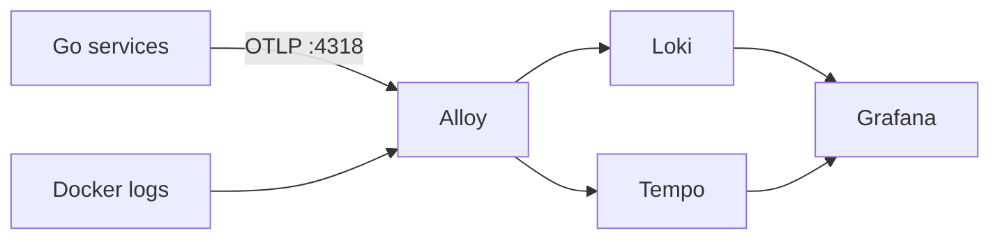

# Observability

Read logs and traces in Grafana instead of SSH-ing into containers.



## Run locally

```bash
task dev:obs
```

Grafana: [http://localhost:8080/grafana](http://localhost:8080/grafana), user `admin`, password `admin` (override with `GRAFANA_PASSWORD`).

`task down` stops everything, including the observability containers.

## Logs

Alloy scrapes containers labeled `eventory.logs=true` into Loki. Query them in Explore → Loki:

```logql
{compose_service="tournament"} | logfmt | request_id="<id>"
```

Use `| json` instead of `| logfmt` in production, where services log JSON. Locally they log logfmt; to switch, set `LOGGING_FORMAT=json` in `backend/services/<service>/.env` and recreate the container.

`frontend` and `traefik` logs are unstructured, so only substring filters work: `{compose_service="traefik"} |= "error"`.

## Traces

Account, Tournament and Payment send traces for inbound HTTP, Tournament → Account gRPC, and Postgres queries. `/health` is skipped.

To see a full HTTP → gRPC → SQL trace locally, call a route that needs an organizer profile:

```bash
curl -X POST http://localhost:8082/api/v1/tournaments \
  -H "Authorization: Bearer dev-token" -H "Content-Type: application/json" -d '{}'
```

Then open Explore → Tempo → Search and pick the `tournament` service.

Every log line written during a traced request carries `trace_id`, so you can jump between the two:

- **Trace → logs:** open a span and use "Logs for this span".
- **Log → trace:** click the `TraceID` link on a log line.

To find the logs for a trace by hand: `{compose_service="tournament"} |= "<trace_id>"`.

## Production

Grafana is public at `https://eventory.ddns.net/grafana`, protected by its own login (`PROD_GRAFANA_PASSWORD`, see [deployment.md](deployment.md)). Loki, Tempo and Alloy are internal to the Compose network, and each obs container has a 256MB memory limit.

## Configuration

| Variable | Effect |
| --- | --- |
| `OTEL_EXPORTER_OTLP_ENDPOINT` | Where services send traces. Unset locally (tracing off) unless `task dev:obs` sets it to `http://alloy:4318`; always set in production. |
| `LOGGING_FORMAT` | `json` (production default) or `text`/logfmt (local default). |
