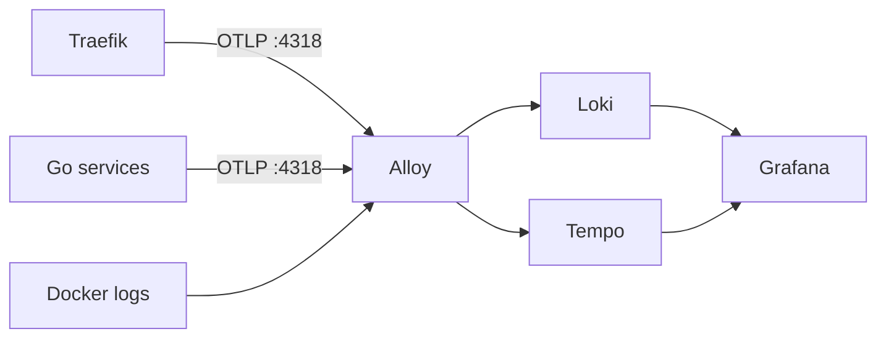

# Observability

Read logs and traces in Grafana instead of SSH-ing into containers.



## Run locally

```bash
task dev:obs
```

Grafana: [http://localhost:8080/grafana](http://localhost:8080/grafana), user `admin`, password `admin` (override with `GRAFANA_PASSWORD`).

`task down` stops everything, including the observability containers.

## Logs

Alloy scrapes containers labeled `eventory.logs=true` into Loki. Query them in Explore → Loki:

```logql
{service_name="tournament"} | logfmt | request_id="<id>"
```

Use `| json` instead of `| logfmt` in production, where services log JSON. Locally they log logfmt; to switch, set `LOGGING_FORMAT=json` in `backend/services/<service>/.env` and recreate the container.

`frontend` and `traefik` logs are unstructured, so only substring filters work: `{service_name="traefik"} |= "error"`.

## Traces

Traefik, Account, Tournament, Payment and Notification send traces. A request through the gateway is one trace:

```text
traefik GET → tournament GET → select … (GORM)
                             → account gRPC → select … (GORM)
                             → payment HTTP → …
```

- **Gateway:** Traefik starts the root span and forwards `traceparent` to the services. Calls straight to a service port (for example `:8082`) start at that service instead.
- **Cross-service calls:** Tournament → Account gRPC and Tournament → Payment HTTP carry the trace context.
- **Messaging:** publishing to RabbitMQ writes `traceparent` into the message headers, and the Notification worker continues the trace, so its GORM queries and logs join the producer's trace. No service publishes yet; `cmd/publish-registration-submitted` shows how a producer should do it.
- **Postgres:** every GORM query is a span under the calling request.
- **MongoDB:** every Tournament Mongo command is a client span such as `find tournament_forms`.
- **Not traced:** `/health` and `/ready`, the browser, and Next.js. Traces start at Traefik. Background pollers in Tournament (lobby and sponsorship, every 10 s) have no parent request, so each tick is its own root trace.

To see a full HTTP → gRPC → SQL trace locally, call a route that needs an organizer profile through the gateway:

```bash
curl -X POST http://localhost:8080/api/v1/tournaments \
  -H "Authorization: Bearer dev-token" -H "Content-Type: application/json" -d '{}'
```

Then open Explore → Tempo → Search and pick the `tournament` service.

Every log line written during a traced request carries `trace_id`, so you can jump between the two:

- **Trace → logs:** open a span and use "Logs for this span".
- **Log → trace:** click the `TraceID` link on a log line.

To find the logs for a trace by hand: `{service_name="tournament"} |= "<trace_id>"`.

## Production

Grafana is public at `https://eventory.ddns.net/grafana`, protected by its own login (`PROD_GRAFANA_PASSWORD`, see [deployment.md](deployment.md)). Loki, Tempo and Alloy are internal to the Compose network, and each obs container has a 512MB memory limit.

## Configuration

| Variable | Effect |
| --- | --- |
| `OTEL_EXPORTER_OTLP_ENDPOINT` | Where Go services send traces. Unset locally (tracing off) unless `task dev:obs` sets it to `http://alloy:4318`; always set in production. |
| `TRAEFIK_TRACING` | Local only. `task dev:obs` sets it to `true` to turn on Traefik's root span; otherwise off. Production always has Traefik tracing on. |
| `LOGGING_FORMAT` | `json` (production default) or `text`/logfmt (local default). |
