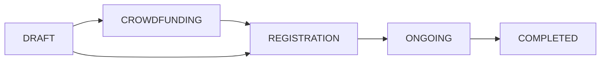
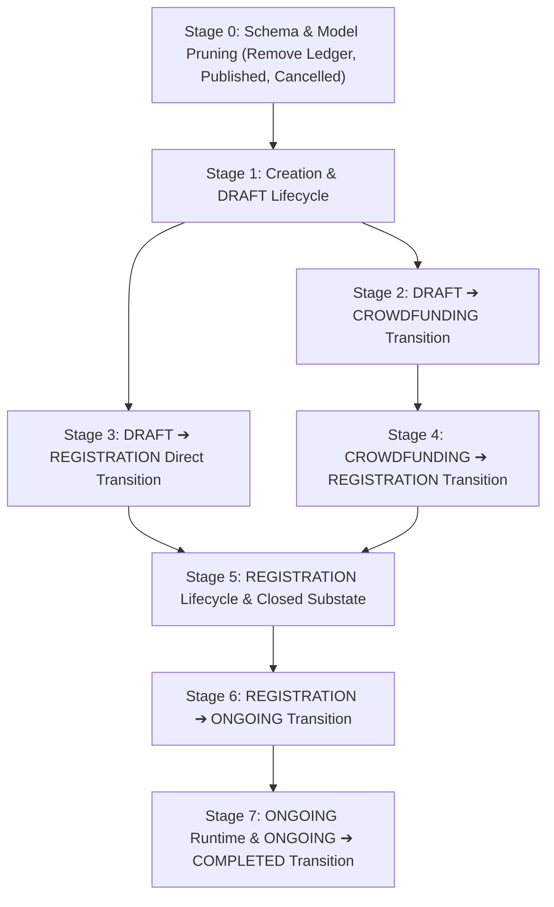

# Tournament Status & Model Refactor Plan

This document outlines the architectural refactoring plan for the tournament lifecycle state machine and data model within the tournament service (`backend/services/tournament`).

---

## 1. Executive Summary & Goals

### 1.1 Objectives
1. **Streamline Tournament Lifecycle**: Collapse redundant statuses (`REGISTRATION_OPEN` and `REGISTRATION_CLOSED` into a unified `REGISTRATION` state with a derived closed substate; remove `CANCELLED`).
2. **Remove Bloat & Anti-Patterns**: Eliminate the over-engineered status audit ledger (`TournamentStatusChange`) and redundant visibility flags (`Published`).
3. **Formalize Field Classifications**: Classify model fields into strict groups (Internal, General Info, Registration Gate, Timeline, Crowdfunding Info, Staff List, Match Bracket) with well-defined mutability rules per stage.
4. **Enforce Rigid Transition Preconditions**: Replace arbitrary status overrides with strict domain-driven transition invariants (e.g. bracket readiness before `ONGOING`, complete match results before `COMPLETED`).
5. **No Backward Compatibility Burden**: Simplify models, database schemas, repository interfaces, and API endpoints directly for clean, maintainable code.



---

## 2. Field Classification & Mutability Matrix

| Field Group | Fields | DRAFT | CROWDFUNDING | REGISTRATION | ONGOING | COMPLETED |
|---|---|:---:|:---:|:---:|:---:|:---:|
| **Internal** | `ID`, `Status`, `Teams` | Managed by system / state transitions | Managed by system | Managed by system | Managed by system | Read-only |
| **General Info** | `Name`, `Description`, `Detail`, `Game`, `Location` | Editable | Editable | Editable | Editable | Read-only |
| **Registration Gate** | `RegistrationMode`, `EntryFee`, `Currency`, `MinTeamSize`, `MaxTeamSize`, `Capacity` | Editable (optional) | Editable | **Locked** | **Locked** | Read-only |
| **Registration Deadline** | `RegistrationDeadline` | Editable (optional) | Editable | **Editable** | **Locked** | Read-only |
| **Timeline** | `StartsAt`, `EndsAt` | Editable (optional) | Editable | Editable | **Locked** | Read-only |
| **Crowdfunding Info** | `Funding` (goal, deadline), Sponsor Tiers | Editable | **Locked** | **Locked** | **Locked** | Read-only |
| **Staff List** | `Staff` | Editable | Editable | Editable | Editable | Editable |
| **Match Bracket** | `Matches` (structure, seeds) | Inactive | Inactive | **Editable ONLY when registration closed** | **Locked** | Read-only |
| **Match Runtime** | `Matches` (venue, schedule, results) | Inactive | Inactive | Inactive | **Editable** | Read-only |

---

## 3. Stages of Refactoring



---

### Stage 0: Initial Cleanup & Schema Pruning

#### 0.1 Remove Status Audit Ledger (`TournamentStatusChange`)
- **Problem**: The existing `TournamentStatusChange` model, its table `tournament_status_changes`, and forced 10–500 character reason logging added unnecessary complexity to state updates.
- **Action**:
  - Delete `backend/services/tournament/models/tournament_status_change.go`.
  - Remove `&TournamentStatusChange{}` from `models.All()` in `models/registry.go`.
  - Delete repository methods `ApplyOverride` and `ListHistory` from `TournamentRepository`.
  - Delete `GET /api/v1/tournaments/{id}/status/history` and the `change` object from status transition responses.
  - Drop table `tournament_status_changes` via migration or drop statements.

#### 0.2 Remove Redundant `Published` Flag
- **Problem**: `Published bool` created split-brain visibility states. A tournament is public if and only if `Status != DRAFT`.
- **Action**:
  - Delete `Published` from `models.Tournament`.
  - In `TournamentRepository.Search`: replace `WHERE published = true` with `WHERE status != 'DRAFT'`.
  - In `database/migrate.go`: update partial GIN and B-Tree indexes:
    ```sql
    CREATE INDEX IF NOT EXISTS idx_tournaments_catalog_search
    ON tournaments USING GIN (
        (name || ' ' || game || ' ' || description) gin_trgm_ops
    )
    WHERE status != 'DRAFT';

    CREATE INDEX IF NOT EXISTS idx_tournaments_public_schedule
    ON tournaments (start_at, id)
    WHERE status != 'DRAFT';
    ```
  - Remove `Published` from API DTOs (`TournamentResponse`, `OrganizerDashboardSummary`).

#### 0.3 Collapse Registration States & Remove `CANCELLED`
- **Definition**:
  ```go
  type TournamentStatus string

  const (
      TournamentStatusDraft        TournamentStatus = "DRAFT"
      TournamentStatusCrowdfunding TournamentStatus = "CROWDFUNDING"
      TournamentStatusRegistration TournamentStatus = "REGISTRATION"
      TournamentStatusOngoing      TournamentStatus = "ONGOING"
      TournamentStatusCompleted    TournamentStatus = "COMPLETED"
  )
  ```
- **Changes**:
  - Replace `TournamentStatusRegistrationOpen` and `TournamentStatusRegistrationClosed` with `TournamentStatusRegistration`.
  - Delete `TournamentStatusCancelled`.
  - Update all database queries, seeds, and unit test stubs to use the 5 canonical statuses.

#### 0.4 Data Model Nullability for Optional Attributes
- **Problem**: In `DRAFT`, registration gate fields and tournament timeline are optional. In Go, `time.Time` defaults to `0001-01-01`, which creates invalid timestamp issues in PostgreSQL when fields are marked `not null`.
- **Solution**:
  - Model `StartsAt`, `EndsAt`, `RegistrationDeadline` as `*time.Time` in database/GORM (or permit nulls in DRAFT).
  - Model `Capacity` as `*int` (or default to 0 / null in DRAFT).
  - In the domain layer, enforce non-nil and valid date relationships (`RegistrationDeadline < StartsAt < EndsAt`) before allowing transitions to `REGISTRATION`.

---

### Stage 1: Creation & `DRAFT` State Lifecycle

#### 1.1 Creation Invariants
- When an organizer creates a tournament (`POST /api/v1/tournaments`):
  - Initial status is always **`DRAFT`**.
  - **Required fields**: `Name`, `Description`, `Game`, `Location`.
  - **Optional fields**: `Detail` (defaults to empty string), Registration Gate (`RegistrationMode`, `EntryFee`, `MinTeamSize`, `MaxTeamSize`, `Capacity`, `RegistrationDeadline`), Timeline (`StartsAt`, `EndsAt`), Crowdfunding requirements.
  - Creator account is assigned `TournamentStaffRoleOwner` in `TournamentStaff`.

#### 1.2 In-Draft Modifications (`PATCH /api/v1/tournaments/{id}`)
- While in `DRAFT`:
  - **General Info**: Can be updated freely.
  - **Registration Gate & Timeline**: Optional; organizer can incrementally update them.
  - **Registration Form**: Stored in MongoDB via `RegistrationFormUseCase.SaveForm`. Editable without restriction.
  - **Crowdfunding Info & Tiers**: Sponsor tiers (`SponsorshipTier`) and funding goal/deadline can be configured and updated freely.
  - **Visibility**: Invisible to public search queries (`WHERE status != 'DRAFT'`). Visible only to the tournament owner in their organizer dashboard.

---

### Stage 2: Transition `DRAFT ➔ CROWDFUNDING`

#### 2.1 Trigger & Endpoint
- Initiated by the owner via dedicated action: `POST /api/v1/tournaments/{id}/publish-crowdfunding` (or `POST /api/v1/tournaments/{id}/transition` with target `CROWDFUNDING`).

#### 2.2 Validation Invariants
Before transitioning:
1. **Ownership**: Caller must be the tournament owner.
2. **Current Status**: Must be `DRAFT`.
3. **General Info**: Must be valid (`Name`, `Game`, `Location`, `Description`).
4. **Crowdfunding Setup**:
   - `Funding` must exist with `GoalAmount > 0`.
   - `Funding.Deadline` must be in the future (`Deadline > now`).
   - At least one active `SponsorshipTier` must be configured with `Price > 0` and `Slots >= 1`.
5. **Registration Gate & Timeline**: Optional at this point (can be completed during `CROWDFUNDING`). If dates are provided, ensure `Funding.Deadline < RegistrationDeadline < StartsAt < EndsAt`.

#### 2.3 Post-Transition State & Locking
- Tournament status becomes `CROWDFUNDING`.
- **LOCKED**: Crowdfunding parameters (`GoalAmount`, `Deadline`) and sponsorship tiers (`SponsorshipTier`) are frozen. Organizers can no longer edit, create, or delete tiers.
- **PUBLIC**: The tournament appears in public searches and accepts sponsorship pledges/payments.

---

### Stage 3: Direct Transition `DRAFT ➔ REGISTRATION`

For tournaments bypassing crowdfunding and moving directly to registration:

#### 3.1 Trigger & Endpoint
- Initiated by the owner via: `POST /api/v1/tournaments/{id}/open-registration` (or transition target `REGISTRATION`).

#### 3.2 Validation Invariants
Before transitioning:
1. **Ownership**: Caller must be tournament owner.
2. **Current Status**: Must be `DRAFT`.
3. **General Info**: Must be valid.
4. **Registration Gate (Mandatory & Complete)**:
   - `Capacity >= 1`.
   - `EntryFee >= 0`.
   - `RegistrationMode` valid (`SOLO` or `TEAM`).
   - If `TEAM`: `1 <= MinTeamSize <= MaxTeamSize`.
   - `RegistrationDeadline` must be in the future (`RegistrationDeadline > now`).
5. **Timeline (Mandatory & Complete)**:
   - `StartsAt` and `EndsAt` must be set.
   - `RegistrationDeadline < StartsAt < EndsAt`.
6. **Registration Form (Optional)**:
   - Registration forms are optional. If created, the form schema is locked against further edits once in `REGISTRATION`.

#### 3.3 Post-Transition State & Locking
- Tournament status becomes `REGISTRATION`.
- **LOCKED**:
   - Registration Form schema is locked against further edits (if one was defined).
   - Registration Gate (`RegistrationMode`, `EntryFee`, `Currency`, `MinTeamSize`, `MaxTeamSize`, `Capacity`) is frozen.
   - *Exception*: `RegistrationDeadline` remains editable during `REGISTRATION`.
- **PUBLIC**: Visible to all players; team lobbies and registration open.

---

### Stage 4: Transition `CROWDFUNDING ➔ REGISTRATION`

For tournaments that conducted crowdfunding and are now ready to open participant registration.

#### 4.1 Trigger & Endpoint
- Initiated by the owner via: `POST /api/v1/tournaments/{id}/open-registration` (or transition target `REGISTRATION`).

#### 4.2 Validation Invariants
Before transitioning:
1. **Ownership**: Caller must be tournament owner.
2. **Current Status**: Must be `CROWDFUNDING`.
3. **Registration Gate (Mandatory & Complete)**:
   - Gate parameters (`Capacity >= 1`, `EntryFee >= 0`, team size rules, `RegistrationDeadline > now`) fully configured.
   - Registration form is optional (if defined, locked upon transition).
4. **Timeline Complete**:
   - `StartsAt` and `EndsAt` configured.
   - `RegistrationDeadline < StartsAt < EndsAt`.
   - If `Funding.Deadline` was set, verify `Funding.Deadline <= RegistrationDeadline`.
5. **Funding Outcome Verification**:
   - Validate whether crowdfunding goal was reached or if the organizer is permitted to progress after campaign conclusion.

#### 4.3 Post-Transition State & Locking
- Tournament status becomes `REGISTRATION`.
- Registration Gate and Registration Form locked (except `RegistrationDeadline`).

---

### Stage 5: `REGISTRATION` Lifecycle & Closed Substate

#### 5.1 Temporal Substate Evaluation
The registration phase is divided into two operational substates evaluated dynamically without database mutations:
```go
func (t *Tournament) IsRegistrationClosed(now time.Time) bool {
    return !now.Before(t.RegistrationDeadline)
}
```

```
REGISTRATION State
├─ Substate: OPEN   (now < RegistrationDeadline)
│  ├─ Players can create lobbies, join, pay, and lock entries
│  ├─ Organizers can review/accept/reject applications
│  ├─ Organizers can extend RegistrationDeadline
│  └─ Match brackets CANNOT be edited
│
└─ Substate: CLOSED (now >= RegistrationDeadline)
   ├─ Applicants can NO LONGER submit or modify entries
   ├─ Organizers finalize review of all remaining applications
   └─ Organizers CAN define and edit Match Brackets
```

#### 5.2 Mutability During `REGISTRATION`
- **General Info**: Editable.
- **Registration Deadline**: May be extended by the owner, provided `RegistrationDeadline < StartsAt`.
- **Tournament Timeline (`StartsAt`, `EndsAt`)**: Editable by the owner, provided `RegistrationDeadline < StartsAt < EndsAt`.
- **Other Registration Gate Fields**: Strictly immutable.
- **Match Brackets**:
  - `now < RegistrationDeadline`: Bracket editing returns an error (`ErrRegistrationStillOpen`).
  - `now >= RegistrationDeadline`: Bracket editing (`DefineBracket`, match layout, seeding) is unlocked.

---

### Stage 6: Transition `REGISTRATION ➔ ONGOING`

#### 6.1 Trigger & Endpoint
- Initiated by owner/admin via: `POST /api/v1/tournaments/{id}/start-tournament` (or transition target `ONGOING`).

#### 6.2 Validation Invariants
Before transitioning:
1. **Current Status**: Must be `REGISTRATION`.
2. **Registration Closed**: Must be strictly past registration deadline (`now >= RegistrationDeadline`).
3. **No Unresolved Applications**:
   - No teams in `FORMING`, `PAYMENT_PENDING`, or `LOCKED`.
   - Every submitted team must be either `ACCEPTED` or `REJECTED`.
4. **Accepted Team Threshold**:
   - Number of accepted teams (`len(acceptedTeams)`) must meet bracket requirements (at least 2 competing teams).
5. **Bracket Completeness**:
   - Match bracket must be defined (at least one match, valid DAG leading to a championship match).
   - **Stage 1 Capacity Check**: $\sum (\text{TeamCount of Stage 1 Matches}) == \text{Accepted Teams Count}$.
   - All Stage 1 matches must have their participant slots seeded with the accepted teams.

#### 6.3 Post-Transition State & Locking
- Tournament status becomes `ONGOING`.
- **LOCKED**:
  - Registration is permanently closed.
  - Bracket graph layout (stages, match connections, team counts, seeding) is locked against structural changes.
  - Roster and team compositions are immutable.

---

### Stage 7: `ONGOING` Runtime & `ONGOING ➔ COMPLETED` Transition

#### 7.1 Permitted Operations During `ONGOING`
- **General Info**: Editable (`Name`, `Description`, `Detail`, `Location`).
- **Match Runtime Data**:
  - Update match schedule (`scheduledAt`) and venue.
  - Record match results and scores (`RecordMatchResults`).
  - Swapping teams between unplayed matches of the same stage (`SwapTeams`).
- **Forbidden**: Modifying bracket tree structure, adding/removing matches, modifying tournament entry rules or timeline.

#### 7.2 Transition `ONGOING ➔ COMPLETED`
- **Trigger**: Initiated by owner/staff after final match, or triggered when final championship match result is saved.
- **Validation Invariants**:
  1. **Current Status**: Must be `ONGOING`.
  2. **Every Match Completed**: For all matches $m \in \text{Matches}$, `m.IsCompleted == true`.
  3. **Undisputed Single Winner**: The championship match (match with `TargetMatchID == nil`) must have recorded placements with exactly one team in rank 1 (`FinalRank == 1`).
- **Post-Transition State**:
  - Status becomes `COMPLETED`.
  - Tournament is in a terminal state; entirely read-only.

---

## 4. Code Quality & Architecture Improvements

### 4.1 Unified Transition Handler Pattern
Instead of a generic `ApplyOverride` with loose string arguments and forced reason strings, implement explicit domain transition handlers:
```go
// Domain transition methods in TournamentUseCase
func (u *TournamentUseCase) LaunchCrowdfunding(ctx context.Context, accountID, tournamentID uuid.UUID) (*models.Tournament, error)
func (u *TournamentUseCase) OpenRegistration(ctx context.Context, accountID, tournamentID uuid.UUID) (*models.Tournament, error)
func (u *TournamentUseCase) StartTournament(ctx context.Context, accountID, tournamentID uuid.UUID) (*models.Tournament, error)
func (u *TournamentUseCase) CompleteTournament(ctx context.Context, accountID, tournamentID uuid.UUID) (*models.Tournament, error)
```
Each transition handler:
1. Obtains an exclusive row lock (`SELECT ... FOR UPDATE`).
2. Evaluates its specific pre-conditions and business invariants.
3. Performs the atomic state update.
4. Returns clean, domain-specific errors on validation failures.

### 4.2 Clean Error Hierarchy
Replace generic status errors with descriptive sentinel errors:
- `ErrCrowdfundingSetupIncomplete`
- `ErrRegistrationGateIncomplete`
- `ErrRegistrationStillOpen` (attempting bracket configuration before registration closes)
- `ErrUnresolvedApplicationsExist` (pending applications exist when attempting to start)
- `ErrBracketStage1Mismatch`
- `ErrUnfinishedMatchesExist` (attempting to complete before all matches finish)
- `ErrNoChampionshipWinner`

### 4.3 Database Integrity & Clean Indexes
Update database migrations to drop unused tables and replace `WHERE published = true` with `WHERE status != 'DRAFT'`:
- Drop table `tournament_status_changes`.
- Partial GIN index for search:
  `CREATE INDEX idx_tournaments_catalog_search ON tournaments USING GIN ((name || ' ' || game || ' ' || description) gin_trgm_ops) WHERE status != 'DRAFT';`
- Schedule index:
  `CREATE INDEX idx_tournaments_public_schedule ON tournaments (start_at, id) WHERE status != 'DRAFT';`

---

## 5. Implementation Roadmap Checklist

- [x] **Stage 0: Pruning & Schema Update**
  - [x] Delete `TournamentStatusChange` model and migration entries.
  - [x] Remove `Published` field from `models.Tournament` and replace DB indexes.
  - [x] Collapse enum to 5 statuses: `DRAFT`, `CROWDFUNDING`, `REGISTRATION`, `ONGOING`, `COMPLETED`.
  - [x] Prune status history endpoints and status audit ledger.
- [x] **Stage 1: DRAFT Implementation**
  - [x] Update `CreateTournament` to initialize status to `DRAFT`.
  - [x] Relax initial mandatory date/gate checks on creation, moving them to transition guards.
  - [x] Restrict public search and unauthenticated reads to `status != 'DRAFT'`.
- [x] **Stage 2: DRAFT ➔ CROWDFUNDING Transition**
  - [x] Implement transition guards for CROWDFUNDING.
  - [x] Verify crowdfunding goal, deadline, and tier definitions.
  - [x] Freeze sponsorship tier modifications once in `CROWDFUNDING`.
- [x] **Stage 3 & 4: ➔ REGISTRATION Transitions**
  - [x] Implement transition guards for `REGISTRATION` (supporting both `DRAFT` and `CROWDFUNDING` sources).
  - [x] Enforce gate parameters and timeline rules (registration form is optional; frozen if defined).
  - [x] Freeze form schema and gate parameters (except deadline).
- [x] **Stage 5: REGISTRATION Closed Substate & Bracket Gate**
  - [x] Guard `DefineBracket` and `SeedStage1` to only permit execution when `now >= RegistrationDeadline`.
  - [x] Update team lobby and registration submission to check `now < RegistrationDeadline`.
- [x] **Stage 6: REGISTRATION ➔ ONGOING Transition**
  - [x] Enforce registration deadline passed (`now >= RegistrationDeadline`).
  - [x] Enforce zero non-terminal teams (no pending/forming/locked applications).
  - [x] Enforce bracket readiness: valid bracket graph, at least 2 teams, Stage 1 capacity equals accepted teams count, and all Stage 1 slots seeded.
  - [x] Lock bracket structure and entries from further modifications.
- [x] **Stage 7: ONGOING ➔ COMPLETED Transition**
  - [x] Enforce all matches completed (`IsCompleted == true`).
  - [x] Enforce single undisputed champion winner (championship match has single team with rank 1).
  - [x] Lock tournament into read-only terminal state.
- [x] **Stage 8: Cleanup & API Sync**
  - [x] Remove deprecated endpoints and status history DTOs.
  - [x] Run test suite: `go test ./services/tournament/...`.
  - [x] Run static analysis: `go vet ./...`.
