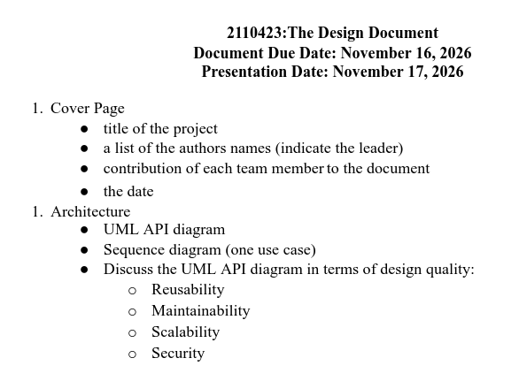
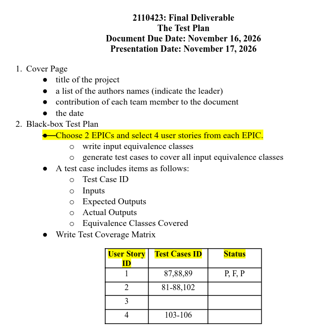

# Tpyst quick tutorial
[Anti-Slop Indicator: 100% - @wachi - กูเขียนเอง] \
Ctrl+Shift+V to preview

## Prerequistle
Install Typst (Pick one)
```sh
# linux
cargo install --locked typst-cli #build from source
# Windows
winget install typst
# Mac
brew install typst
```
Install Extension \
If u use vs code, go to `extension` -> install `Tinymist Typst`

Install fonts \
(idk, use recommned Eng fonts for IEEE, ACM, TH Sarabun New?)

Verify
```sh
typst --version
```

## Basic
```
Blank line to new paragraph
= Header
== Subheader
*bold*
- item
+ numbered item
`code`
#link("url")[text]
_italic_
// comment
$x^2$ inline math
$ x^2 $ math on own line
#figure(image("a.png"), caption: [Caption])
#table(columns: 2, [a], [b], [c], [d])
@key cite paper from refs.bib
= Intro <intro>   then refer with @intro
-- en dash, --- em dash
```

## Run
```bash
cd docs/report

# live preview
typst watch design.typ design.pdf
typst watch test-plan.typ test-plan.pdf

#export
typst compile design.typ design.pdf
typst compile test-plan.typ test-plan.pdf
```

# Instruction

Design \


Test plan \


# Task

Responsibility
- **Ham, Tawan, Not** → `design/uml-api.typ`: UML API diagram + explanation
- **Film** → `design/sequence.typ`: sequence diagram for 1 use case
- **Film** → `design/quality.typ`: Reusability · Maintainability · Scalability · Security
- **Eff, Pun** → `test-plan/epic-a.typ`: EPIC A, 4 stories → equivalence classes + test cases
- **Mavin, Imtaez** → `test-plan/epic-b.typ`: EPIC B, 4 stories → equivalence classes + test cases
- **Eff, Pun, Mavin, Imtaez** → code review: check tests in `backend/tests/` and `backend/internal/**/*_test.go`, flag weird or over-engineered ones
- **Wachi** → `appendix/iso29110.typ`: ISO 29110 checklist
- **Everyone** → `design.typ`, `test-plan.typ`: your % + contribution on each cover

Rule
- 🔴 Red `TODO` box = not done. Final PDF has **zero** red boxes.
- 🖼️ Adding Diagrams → export SVG/PNG into `img/`, then swap `#placeholder[...]` for the commented `#figure(...)` line.
- 🔢 Test case IDs unique across the whole test plan: EPIC A `TC01…`, EPIC B `TC51…`.
- 📊 Coverage matrix is **auto-built** from your `#test-cases(...)`. Don't edit it.

**Design Document**
- UML API diagram: class diagram of the API layer, endpoints as operations
- Sequence diagram: 1 use case, same operation names as the UML API diagram
- Design quality: discuss the UML API diagram on Reusability, Maintainability, Scalability, Security

→ UML API diagram first; sequence diagram + design quality build on it. Existing diagrams: `docs/arch/`.

**Test plan**
- Choose 2 Epic, 4 user stories each
- Per story: input equivalence classes → test cases covering every class
- Test case: ID, Inputs, Expected Output, Actual Output, EC covered
- Test Coverage Matrix → auto-built

→ Stories + acceptance criteria: `docs/backlog/`.


